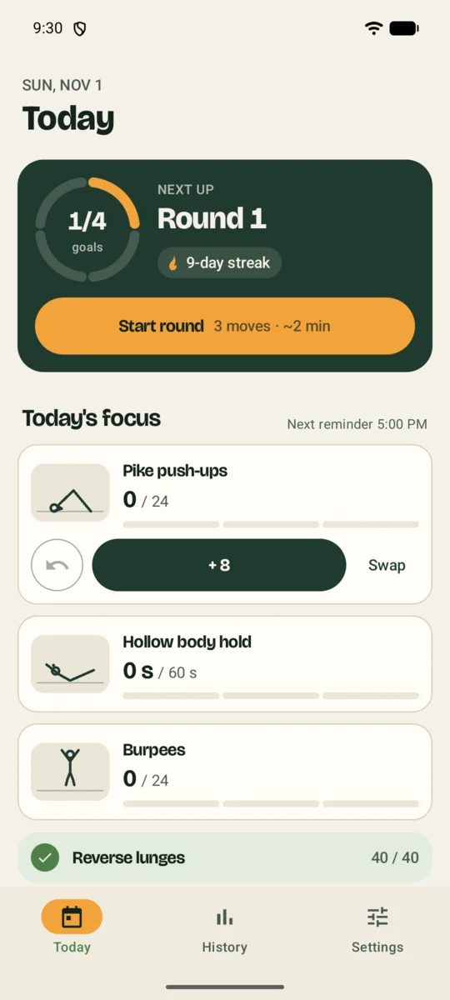
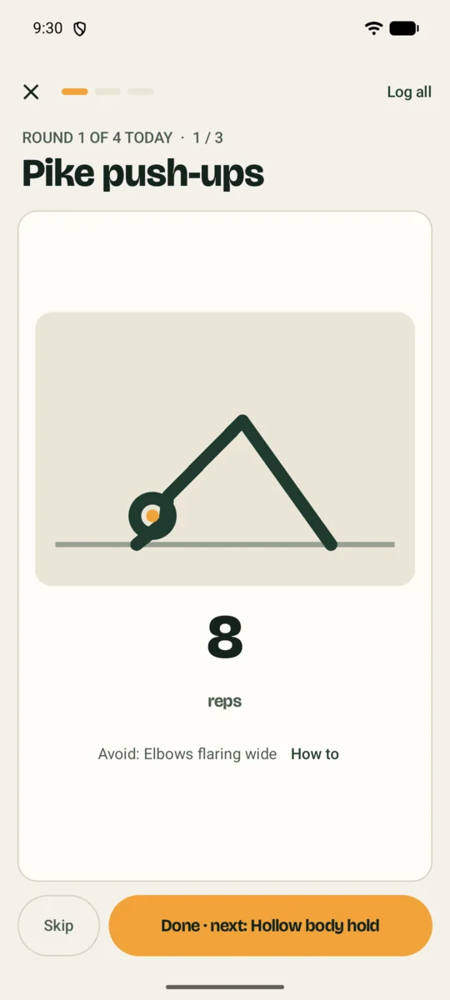
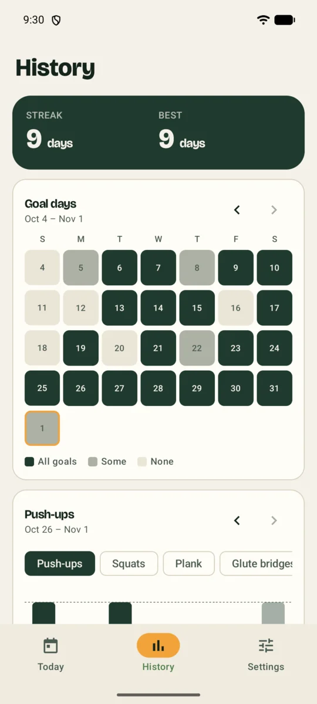
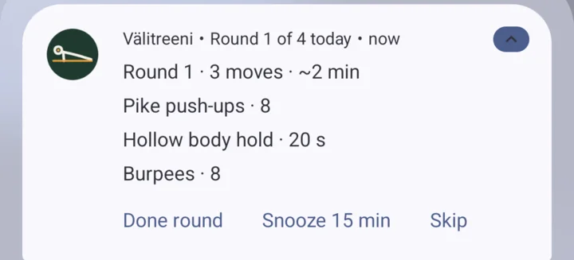
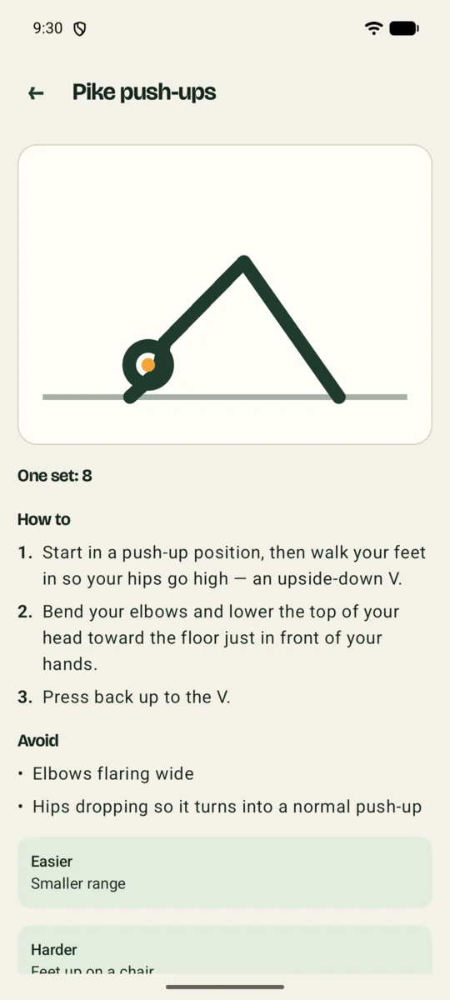
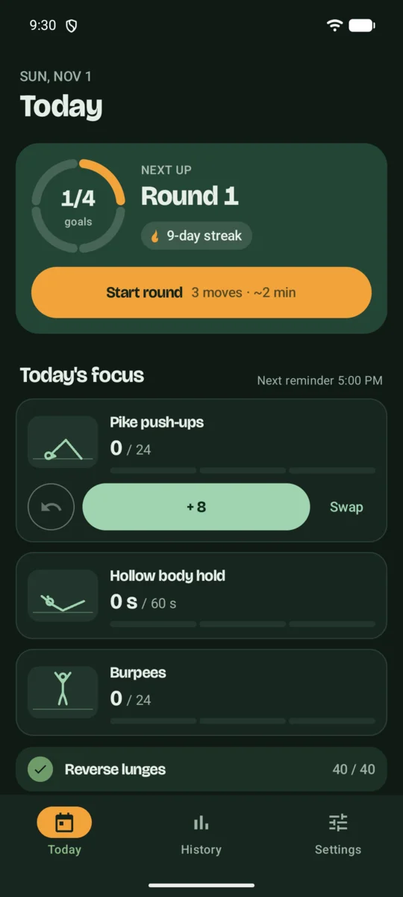

# Välitreeni

**Small workouts that fit between everything else.**

Välitreeni (Finnish for "in-between workout") is an Android app for doing bodyweight exercises at home in short bursts across the day, instead of finding an hour for the gym. A few times a day it reminds you to do one quick round, a set of each of today's moves. That takes two or three minutes, and by the evening the day's goals are done.

  
  &nbsp;
  
  &nbsp;
  

## How it works

**Four moves a day.** Each day Välitreeni picks four moves: push-ups, squats, plank, glute bridges, burpees and more. It takes one from each body area and starts with the ones you haven't done for longest, so everything comes around every few days and nothing gets left out.

**Reminders do the planning.** At the times you choose, a notification lists the round: one set of every move that's still short of today's goal. Do them on the spot and tap **Done round**. You don't even need to open the app. If now is a bad time, snooze it.

  

**Or go one move at a time.** In the app, **Start round** walks you through the round with a big animated figure for each move, a countdown for holds like the plank, and a buzz when time is up.

**Moves that fit you.** Most moves come in easier and harder versions, from wall push-ups to push-ups and from chair sit-to-stands to squats. After each set in the app, tap **Too hard**, **OK** or **Too easy**. Overnight Välitreeni adjusts the set size, and moves you to a harder or easier version when you're ready. If a move is too much right now, **Easier version** swaps it on the spot. On first launch you pick where to start: Gentle (standing, chair and wall moves, nothing on the floor), Middle or Strong. There's also a setting to avoid moves on the floor.

**Learn the moves.** Every move has a tutorial with steps, common mistakes, and tips for making it easier or harder.

**Keep the streak.** A day counts when every goal is met. History shows your current and best streak, five weeks of goal days, and a weekly chart for each move.

  
  &nbsp;
  

### Also

- Your own moves, goals and set sizes, and you can turn off moves you don't want.
- English and Finnish.
- Light and dark mode.
- Your training stays on your phone: no account, no ads, no tracking. The app goes online only to check this page for a newer version, and you can turn that off.
- Updates itself. When a new version is out, the Today screen offers it; tap **Update**, then confirm in Android's own dialog.

## Get it

Välitreeni runs on **Android 15 or newer**. It isn't on Google Play; you install it from here.

1. On your phone, open **[the latest release](https://github.com/nikolauska/valitreeni/releases/latest)** and tap the `.apk` file to download it.
2. Open the downloaded file. Android asks you to allow installing apps from your browser. Allow it, go back, and tap **Install**.
3. Open Välitreeni and allow notifications, so the reminders can reach you.

From then on the app updates itself. The first time it does, Android asks you to allow Välitreeni to install updates. Every update then asks you to confirm with **Update**, so nothing installs behind your back.

### Make sure reminders arrive

Some phones, OnePlus, Xiaomi and Samsung among them, stop apps in the background to save battery, and reminders then quietly stop coming. If the Today screen shows a yellow strip about background use, tap **Fix** and allow it. On a OnePlus, also open **Settings** in the app, tap the battery chip next to **Reminders**, then **Battery**, and choose **Unrestricted**.

If a reminder ever doesn't arrive, the Today screen tells you.

## Contributing

Build instructions, tests and how releases are made are in [CONTRIBUTING.md](CONTRIBUTING.md).

The heading font is [Bricolage Grotesque](https://github.com/ateliertriay/bricolage), used under the SIL Open Font License (`licenses/BricolageGrotesque-OFL.txt`).
